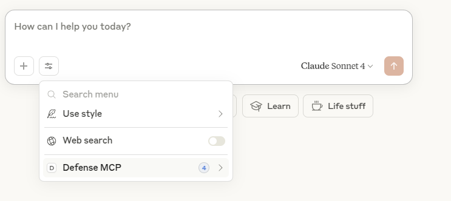
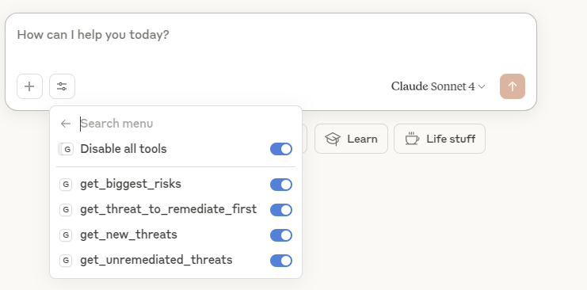
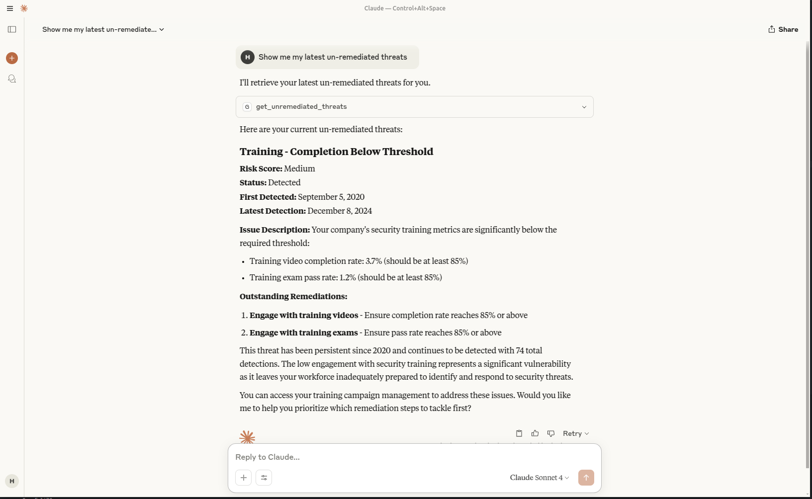

# Defense.com MCP Server

> **Model Context Protocol (MCP) integration for Defense.com Threat Portal**

[](https://opensource.org/licenses/MIT)
[](https://www.python.org/downloads/)
[](https://modelcontextprotocol.io/)

This MCP server enables AI assistants to access real-time threat intelligence from Defense.com's Threat Portal API. Transform your security operations by giving AI models direct access to your threat data for enhanced analysis, prioritization, and decision-making.

## 📋 Prerequisites

- **Python 3.8+**
- **Defense.com API Token** - Generate from your [Defense.com Portal](https://my.defense.com)
- **MCP-compatible client** ([Claude Desktop](https://claude.ai/download), OpenAI with MCP, etc.)
- **UV package manager** (optional, for `mcp install` command)

## 🚀 Installation & Setup

### Step 1: Clone and Setup Environment

```bash
# Clone the repository
git clone https://github.com/defensedotcom/defense-mcp.git
cd defense-mcp

# Create and activate virtual environment (recommended)
python3 -m venv .venv
source .venv/bin/activate  # On Windows: .venv\Scripts\activate
```

### Step 2: Install Dependencies

```bash
# Install project dependencies
pip install -r requirements.txt

# Ensure MCP CLI is available
pip install "mcp[cli]>=1.6.0"
```

### Step 3: Configure Environment Variables

Create a `.env` file for testing (optional but recommended):
```bash
# Create .env file with your API credentials
cat > .env << EOF
DEFENSE_API_TOKEN=your_token_here
DEFENSE_API_BASE_URL=https://api.defense.com
EOF
```

Or set environment variables manually:
```bash
export DEFENSE_API_TOKEN="your_token_here"
export DEFENSE_API_BASE_URL="https://api.defense.com"
```

### Step 4: Verify Installation

Test the server starts without errors:
```bash
python defense_mcp.py
```

> **Note**: The server will start and wait for MCP client connections. You should see:
> ```
> Starting Defense MCP Server v1.0.0...
> Using DEFENSE_API_BASE_URL: https://api.defense.com
> ```
> 
> Press `Ctrl+C` to stop the server. If Ctrl+C doesn't work, use `Ctrl+Z` followed by `kill %1` or force quit with `kill -9 <PID>`. If you see environment variable errors, ensure your API credentials are set correctly.

## Client Integration

### Claude Desktop

#### Option A: Automatic Installation (requires UV)

1. **Install UV if not already installed:**
   ```bash
   # macOS/Linux
   curl -LsSf https://astral.sh/uv/install.sh | sh
   
   # Windows
   powershell -ExecutionPolicy ByPass -c "irm https://astral.sh/uv/install.ps1 | iex"
   ```

2. **Install the MCP server:**
   ```bash
   mcp install defense_mcp.py --name "Defense MCP"
   ```
   
   This will generate the basic configuration structure in your Claude Desktop config file.

#### Option B: Manual Configuration (no UV required)

3. **Add your API credentials manually.**
   
   Edit your Claude Desktop configuration file (`claude_desktop_config.json`) and add the `env` section with your API credentials:

   **Configuration file locations:**
   - **macOS**: `~/Library/Application Support/Claude/claude_desktop_config.json`
   - **Windows**: `%APPDATA%\Claude\claude_desktop_config.json`
   - **Linux**: `~/.config/Claude/claude_desktop_config.json`

   The `mcp install` command creates a basic structure without the `env` section. You need to add the `env` section manually:

   ```json
   {
     "mcpServers": {
       "Defense MCP": {
         "command": "uv",
         "args": [
           "run",
           "--with",
           "mcp[cli]",
           "mcp",
           "run",
           "/your/actual/path/to/defense_mcp.py"
         ],
         "env": {
           "DEFENSE_API_TOKEN": "your_actual_api_token_here",
           "DEFENSE_API_BASE_URL": "https://api.defense.com"
         }
       }
     }
   }
   ```

4. **Update the configuration:**
   - Add the entire `"env": { ... }` section if it doesn't exist
   - Replace `your_actual_api_token_here` with your actual Defense API token
   - Verify the path in `args` is correct (it should already be absolute from `mcp install`)
   - Update the base URL if different from `https://api.defense.com`

5. **Restart Claude Desktop** and look for the 🔌 MCP indicator in the bottom-left corner

> 🔑 **Getting your API Token**: Log into your Defense.com Portal → Account → API Keys → Add API Key

### 🔄 Rotating Your API Key

When rotating or renewing your `DEFENSE_API_TOKEN`:
1. Update `DEFENSE_API_TOKEN` with your new token in `claude_desktop_config.json` (or your `.env` file).
2. Save the configuration file.
3. **Restart Claude Desktop completely**: MCP server sub-processes inherit environment variables when launched. Claude Desktop must be fully closed and reopened for the new API token to take effect. If not restarted, requests will continue using the old/revoked token and fail with `401 Unauthorized`.

### Verifying Installation

Once installed and configured correctly, you should see the Defense MCP server available in Claude Desktop:

**Step 1: Check MCP Server Connection**

Look for "Defense MCP" in the tools menu with indicator showing available tools.

**Step 2: Verify All Tools Are Available**

You should see all tools listed and enabled (blue toggles).

**Step 3: Test with Real Queries**

Once connected, you can ask natural language questions and see the MCP server retrieve real threat data from your Defense.com portal.

1. **Manually add the configuration** to your Claude Desktop config file (`claude_desktop_config.json`):

   **Configuration file locations:**
   - **macOS**: `~/Library/Application Support/Claude/claude_desktop_config.json`
   - **Windows**: `%APPDATA%\Claude\claude_desktop_config.json`
   - **Linux**: `~/.config/Claude/claude_desktop_config.json`

2. **Use the direct Python approach** (no UV required):

```json
{
  "mcpServers": {
    "Defense MCP": {
      "command": "python",
      "args": ["/absolute/path/to/defense_mcp.py"],
      "env": {
        "DEFENSE_API_TOKEN": "your_token_here",
        "DEFENSE_API_BASE_URL": "https://api.defense.com"
      }
    }
  }
}
```

3. **Update the configuration:**
   - Replace `your_token_here` with your actual Defense API token
   - Update `/absolute/path/to/defense_mcp.py` with the correct path to your script
   - Update the base URL if different from `https://api.defense.com`

4. **Restart Claude Desktop** and look for the 🔌 MCP indicator in the bottom-left corner

### Alternative: Using UV (Advanced)

If you prefer using UV or the `mcp install` command generated a UV-based configuration:

```json
{
  "mcpServers": {
    "Defense MCP": {
      "command": "uv",
      "args": [
        "run",
        "--with",
        "mcp[cli]",
        "mcp",
        "run",
        "/absolute/path/to/defense_mcp.py"
      ],
      "env": {
        "DEFENSE_API_TOKEN": "your_token_here",
        "DEFENSE_API_BASE_URL": "https://api.defense.com"
      }
    }
  }
}
```

## 🛠️ Available Tools

<details>
<summary><strong>Core Threat Intelligence Tools</strong></summary>

| Tool | Description | Parameters |
|------|-------------|------------|
| `get_biggest_risks` | Retrieve top critical/high severity threats with pagination | None |
| `get_new_threats` | Get recent threats from the last N days using full pagination | `days` (1-365) |
| `get_threat_to_remediate_first` | Find highest priority unremediated threat | `days` (optional, default: 1) |
| `search_threats_by_keyword` | Search threats by keyword in title/description | `keyword`, `include_description` (default: true) |
| `get_latest_detections` | Get latest detection events with optional threat filtering | `days` (1-365), `threat_id` (optional) |

</details>

<details>
<summary><strong>Team & Workload Management Tools</strong></summary>

| Tool | Description | Parameters |
|------|-------------|------------|
| `get_threats_by_assignee` | Get all threats assigned to a specific person with risk breakdown | `assignee_email` |
| `get_threats_by_source` | Filter threats by detection source type with risk analysis | `source_type` |
| `get_workload_analysis` | Comprehensive dashboard view of threat workload and aging | None |
| `get_threat_details_with_context` | Get complete threat details with assets, users, and detections | `threat_id` |

</details>

<details>
<summary><strong>Security Training & Education Tools</strong></summary>

| Tool | Description | Parameters |
|------|-------------|------------|
| `generate_training_questions` | Create security training questions with configurable difficulty | `threat_id`, `threat_type`, `difficulty`, `count` (1-10) |
| `get_training_for_threat` | Generate contextual training content for specific threat | `threat_id` |
| `get_security_awareness_brief` | Create security briefing based on current threat landscape | None |
| `start_training_session` | Begin interactive training session with progress tracking | `threat_id`, `difficulty`, `session_type` |
| `submit_training_answer` | Submit answer and optionally get next question | `session_id`, `answer`, `request_next` |
| `get_training_hint` | Get hint for current training question | `session_id` |
| `get_training_session_status` | Check training session progress and completion | `session_id` |

</details>

<details>
<summary><strong>Debug & Utility Tools</strong></summary>

| Tool | Description | Parameters |
|------|-------------|------------|
| `debug_date_filtering` | Debug date filtering functionality with multiple format tests | None |
| `test_pagination_and_recent_threats` | Test pagination performance and threat distribution analysis | None |

</details>

### Enhanced Features

**Comprehensive Pagination Support**: All threat retrieval tools now support full pagination to ensure complete data access across large threat databases.

**Advanced Workload Analytics**: The workload analysis tool provides dashboard-like insights including:
- Active vs. remediated threat distribution
- Threats older than 30 days analysis
- Risk score breakdowns by assignee
- Overall threat state analysis

**Interactive Training System**: Complete training session management with:
- Session tracking and progress monitoring
- Hint system for guided learning
- Configurable difficulty levels and question types
- Support for threat-specific training content

**Enhanced Detection Monitoring**: Latest detections tool includes:
- Threat-specific detection filtering
- Asset and user impact analysis
- Detection count aggregation per threat

### Example AI Queries

Once connected, you can ask your AI assistant natural language questions:

<details>
<summary><strong>Threat Intelligence & Risk Assessment</strong></summary>

- *"What are our biggest security risks right now?"*
- *"Show me new threats from the last 3 days"*
- *"Which threat should our team prioritize for remediation?"*
- *"Find all threats related to 'Windows SMB'"*
- *"Show me the latest detection events for threat ID abc123"*

</details>

<details>
<summary><strong>Team & Workload Management</strong></summary>

- *"Show me all threats assigned to john@company.com"*
- *"How is our security workload distributed across the team?"*
- *"Which threats are older than 30 days and still active?"*
- *"Show me all SIEM-generated threats with their risk breakdown"*
- *"Give me a dashboard view of our current threat landscape"*

</details>

<details>
<summary><strong>Security Training & Education</strong></summary>

- *"Generate 5 advanced ransomware training questions"*
- *"Create training content for threat ID def456"*
- *"Start a phishing awareness training session for me"*
- *"Give me a security awareness brief based on our current threats"*
- *"I need a hint for my current training question"*

</details>

<details>
<summary><strong>Detailed Investigation</strong></summary>

- *"Give me full details on threat f45789d4-2a26-4f84-8569-a3115d6168d5"*
- *"Show me all affected assets and users for this security issue"*
- *"Search for all threats containing 'Exchange Server'"*
- *"What detection events happened in the last 24 hours?"*

</details>

The AI assistant will automatically use the appropriate Defense MCP tools to fetch real-time data from your Defense.com Threat Portal and provide detailed analysis, recommendations, and training content tailored to your specific security landscape.

## Sample Response

```json
{
  "threats": [
    {
      "id": "threat-abc123",
      "risk_score": "critical",
      "title": "Ransomware Activity Detected",
      "description": "Suspicious encryption activity detected on multiple endpoints",
      "assets_count": 10,
      "aasm_state": "detected",
      "created_at": "2025-06-10T08:30:00Z"
    }
  ],
  "total_count": 1,
  "pages_checked": "Critical: 2, High: 5",
  "filtering_method": "local_with_full_pagination"
}
```

## Training Templates

The server includes comprehensive training templates for:

- **Ransomware**: Detection, response, and prevention strategies
- **Malware**: Analysis and remediation techniques  
- **Phishing**: Identification and incident response
- **Vulnerability Management**: Prioritization and patching strategies
- **Network Security**: Protocol security and threat detection
- **General Security**: Fundamental cybersecurity concepts

## Dependencies

- **httpx 0.28.1**: Async HTTP client for API communications
- **mcp 1.9.4**: Model Context Protocol framework
- **pydantic 2.11.7**: Data validation and serialization

## Troubleshooting

### Common Issues

**MCP Server Not Connecting**
- Verify your API token is correct and has proper permissions
- Check that `DEFENSE_API_BASE_URL` points to the correct endpoint
- Ensure Python path in configuration is absolute
- Restart Claude Desktop after making configuration changes

**"No tools available" Error**
- Check that the `env` section was added to your configuration file
- Verify all tools are visible in the Claude Desktop tools menu
- Ensure server logs show no errors: `python defense_mcp.py`
- Verify MCP CLI is installed: `pip list | grep mcp`

**Authentication Errors (HTTP 401)**
- Regenerate your API token from Defense.com Portal
- Ensure token has read permissions for threat data
- Verify the API base URL is correct
- If you recently rotated or changed your API token, **fully restart Claude Desktop** to reload environment variables

**Tools Not Showing in Claude**
- Confirm "Defense MCP" appears in the tools menu
- Check that all tools are enabled (blue toggles)
- Try disabling and re-enabling individual tools

**Pagination Issues**
- Use debug tools (`debug_date_filtering`, `test_pagination_and_recent_threats`) to troubleshoot
- Check server logs for pagination performance metrics
- Verify API rate limits are not being exceeded

### Debug Mode

Enable detailed logging by running the server directly:
```bash
python defense_mcp.py
```

This will show connection attempts, API calls, pagination details, and any error messages.

## Development

### Running in Development

```bash
# Hot reload during development
uv run --with mcp[cli] mcp run defense_mcp.py

# Or standard Python
python defense_mcp.py
```

### Contributing

We welcome contributions! Please:

1. Fork the repository
2. Create a feature branch: `git checkout -b feature/amazing-feature`
3. Commit changes: `git commit -m 'Add amazing feature'`
4. Push to branch: `git push origin feature/amazing-feature`
5. Open a Pull Request

## License

This project is licensed under the MIT License - see the [LICENSE](LICENSE.md) file for details.

## Support

- **Documentation**: [Defense.com API Docs](https://docs.defense.com)
- **Issues**: [GitHub Issues](https://github.com/your-org/defense-mcp-server/issues)
- **Enterprise Support**: Contact [Defense.com](https://defense.com/contact)

## Related Projects

- [Model Context Protocol](https://modelcontextprotocol.io/) - Official MCP documentation
- [Claude MCP Guide](https://modelcontextprotocol.io/quickstart/user) - Claude Desktop setup
- [Defense.com Portal](https://my.defense.com) - Generate API tokens

---

**Made with ❤️ by the Defense.com team**